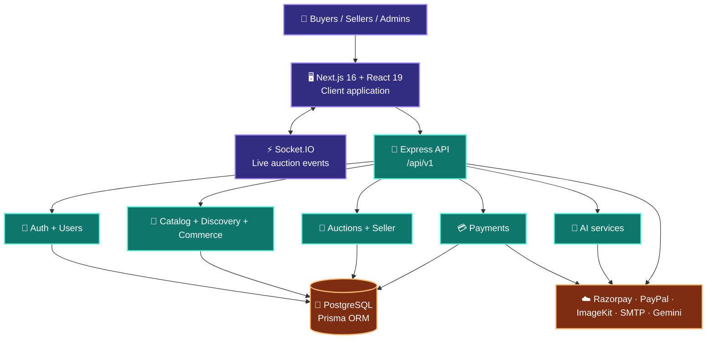

<div align="center">

# 🏛️ Auction Marketplace

### **A real-time auction and commerce platform built for discovering, bidding, buying, and selling with confidence.**

<p>
  <a href="https://auctionfrontend-gamma.vercel.app/"></a>
  <a href="https://github.com/SazzzNiziyan/Auction-marketplace"></a>
  
</p>


<br />

```text
                 ┌─────────────────────────────────────────────┐
                 │              AUCTION MARKETPLACE             │
                 │                                             │
                 │   🔍 Discover  →  ⚡ Bid  →  🏆 Win  →  📦 Buy │
                 └─────────────────────────────────────────────┘
```

</div>

---

## ✨ What is Auction Marketplace?

**Auction Marketplace** is a full-stack TypeScript platform that combines live auctions with traditional e-commerce workflows. Buyers can explore products, participate in auctions, manage carts and checkouts, while sellers can manage listings and auction activity from dedicated experiences.

The project is organized as a modern monorepo-style application:

- `Client/` — Next.js frontend with responsive marketplace experiences.
- `server/` — Express API with Prisma, PostgreSQL, authentication, payments, real-time events, and modular domain services.

> **Live application:** [auctionfrontend-gamma.vercel.app](https://auctionfrontend-gamma.vercel.app/)

## 🎬 Experience at a glance

<div align="center">

| 🧭 Discover | ⚡ Participate | 💳 Transact | 🛠️ Operate |
|:---:|:---:|:---:|:---:|
| Explore products, categories, search, and recommendations | Join auction rooms and receive real-time updates | Cart, checkout, deposits, payments, and commerce workflows | Seller, admin, user, and AI-enabled modules |

</div>

## 🌟 Core capabilities

### 🛍️ Marketplace experience

- Product and catalog discovery
- Category browsing and search routes
- Product detail pages
- Buyer storefront and shopping flows
- Cart and checkout experiences
- Responsive UI built with reusable React components

### 🔨 Auction experience

- Auction-focused pages and workflows
- Real-time auction rooms powered by Socket.IO
- Auction-specific rooms for public broadcasts
- User rooms for private notifications such as outbid, winning, and deposit-refund events
- Configurable caution deposits and platform commission settings

### 👤 Account and role experiences

- Authentication routes and protected user flows
- Buyer and seller areas
- Admin area for platform operations
- User management foundations
- Seller listing and commerce workflows

### 💰 Payments and communication

- Razorpay integration support
- PayPal client integration support
- Payment and webhook configuration
- SMTP email configuration
- ImageKit media integration
- JWT access and refresh token configuration

### 🤖 Platform intelligence

- Dedicated AI backend module
- Gemini API configuration support
- Discovery and recommendation-oriented module boundaries
- Swagger API documentation setup

## 🧱 3D architecture view



## 🧰 Technology stack

<div align="center">

| Layer | Technologies |
|---|---|
| Frontend | Next.js `16.3.6`, React `19.2.8`, TypeScript, Tailwind CSS v4 |
| UI | Lucide React, React Icons, Swiper, `clsx`, `tailwind-merge` |
| Backend | Node.js, Express `5`, TypeScript, Zod |
| Data | PostgreSQL, Prisma `5` |
| Real-time | Socket.IO `4` |
| Security | Helmet, CORS, rate limiting, bcryptjs, JWT, cookies |
| Payments | Razorpay, PayPal React SDK |
| Media | ImageKit |
| Email | Nodemailer / SMTP |
| API docs | Swagger JSDoc, Swagger UI Express |
| Testing | Vitest, Supertest |
| Deployment | Vercel-ready frontend; Node.js backend |

</div>

## 📁 Project structure

```text
Auction-marketplace/
├── Client/
│   ├── public/                 # Static assets
│   ├── src/
│   │   ├── app/                # Next.js App Router pages
│   │   │   ├── admin/           # Admin experience
│   │   │   ├── auction/         # Auction pages
│   │   │   ├── auth/            # Authentication pages
│   │   │   ├── buyer/           # Buyer dashboard and flows
│   │   │   ├── cart/            # Cart experience
│   │   │   ├── category/        # Category browsing
│   │   │   ├── checkout/        # Checkout experience
│   │   │   ├── explore/         # Discovery experience
│   │   │   ├── product/         # Product pages
│   │   │   ├── search/          # Search experience
│   │   │   ├── seller/          # Seller experience
│   │   │   └── store/           # Storefront experience
│   │   ├── components/          # Shared UI components
│   │   └── lib/                 # Client utilities and integrations
│   └── package.json
│
└── server/
    ├── prisma/                 # Prisma schema, migrations, and seed data
    ├── src/
    │   ├── config/              # Environment, database, Swagger config
    │   ├── integrations/        # External service integrations
    │   ├── middleware/           # Security and error middleware
    │   ├── modules/
    │   │   ├── admin/
    │   │   ├── ai/
    │   │   ├── auctions/
    │   │   ├── auth/
    │   │   ├── catalog/
    │   │   ├── commerce/
    │   │   ├── discovery/
    │   │   ├── payments/
    │   │   ├── seller/
    │   │   └── users/
    │   ├── utils/
    │   ├── app.ts               # Express, routes, Socket.IO, middleware
    │   └── server.ts             # Database connection and HTTP startup
    └── tests/                   # Backend tests
```

## 🚀 Quick start

### 1. Clone the repository

```bash
git clone https://github.com/SazzzNiziyan/Auction-marketplace.git
cd Auction-marketplace
```

### 2. Install frontend dependencies

```bash
cd Client
npm install
```

### 3. Install backend dependencies

```bash
cd ../server
npm install
```

### 4. Configure the backend environment

```bash
cp .env.example .env
```

Update `.env` with your PostgreSQL credentials and service keys. At minimum, configure:

- `DATABASE_URL`
- `JWT_SECRET`
- `JWT_REFRESH_SECRET`
- `CORS_ORIGIN`
- Payment provider credentials when payment flows are enabled
- ImageKit credentials when media uploads are enabled
- SMTP credentials when email delivery is enabled
- `GEMINI_API_KEY` when AI features are enabled

### 5. Prepare Prisma

```bash
cd server
npm run db:generate
npm run db:migrate
# Optional: seed development data
npm run db:seed
```

### 6. Start the backend

```bash
npm run dev
```

The API runs on `http://localhost:4000` by default.

### 7. Start the frontend

Open a second terminal:

```bash
cd Client
npm run dev
```

Open [http://localhost:3000](http://localhost:3000).

## 📜 Useful commands

### Frontend

```bash
cd Client
npm run dev       # Start Next.js development server
npm run build     # Create production build
npm run start     # Start production server
npm run lint      # Run ESLint
```

### Backend

```bash
cd server
npm run dev             # Watch mode with tsx
npm run build           # Compile TypeScript
npm run start           # Start compiled server
npm run lint            # Type-check without emitting
npm run test            # Run tests
npm run test:watch      # Watch tests
npm run test:coverage   # Generate coverage
npm run db:generate     # Generate Prisma Client
npm run db:migrate      # Create/apply development migration
npm run db:migrate:deploy # Apply production migrations
npm run db:reset        # Reset development database
npm run db:seed         # Seed database
npm run db:studio       # Open Prisma Studio
```

## 🔌 API surface

The backend exposes versioned routes under `/api/v1`:

| Domain | Base route |
|---|---|
| Authentication | `/api/v1/auth` |
| Users | `/api/v1/users` |
| Catalog | `/api/v1/catalog` |
| Seller | `/api/v1/seller` |
| Discovery | `/api/v1/discovery` |
| Commerce | `/api/v1/commerce` |
| Auctions | `/api/v1/auctions` |
| Payments | `/api/v1/payments` |
| Administration | `/api/v1/admin` |
| AI | `/api/v1/ai` |
| Health check | `/health` |
| API documentation | Swagger endpoint configured by the server |

## 🔐 Security notes

- Never commit `.env` files or real credentials.
- Use long, randomly generated JWT secrets.
- Keep Razorpay, ImageKit, SMTP, and Gemini keys server-side.
- Use test-mode payment credentials during development.
- Configure `CORS_ORIGIN` to the exact frontend origin in production.
- Review Socket.IO room authorization before exposing private user events publicly.

## 🧪 Testing and quality

The backend includes a Vitest/Supertest setup. Before opening a pull request, run:

```bash
cd server
npm run lint
npm run test
npm run build
```

For frontend changes:

```bash
cd Client
npm run lint
npm run build
```

## 🛣️ Suggested roadmap

- [ ] Add automated CI for frontend and backend checks
- [ ] Add screenshots or product walkthrough GIFs to this README
- [ ] Add OpenAPI examples for the most important auction and payment flows
- [ ] Add end-to-end tests for buyer, seller, and admin journeys
- [ ] Add observability for live auction events and payment webhooks
- [ ] Add production deployment documentation for the backend and database

## 🤝 Contributing

1. Fork the repository.
2. Create a feature branch: `git checkout -b feat/your-feature`.
3. Make focused changes and add tests where appropriate.
4. Run lint, tests, and builds for the affected application.
5. Open a pull request with a clear description and screenshots for UI changes.

## 📄 License

The repository currently does not declare a license. Add a license file before distributing or reusing the project commercially.

<div align="center">

### Built with TypeScript, Next.js, Express, Prisma, and a little auction-room adrenaline. ⚡

<a href="https://auctionfrontend-gamma.vercel.app/">Enter the marketplace →</a>

</div>
